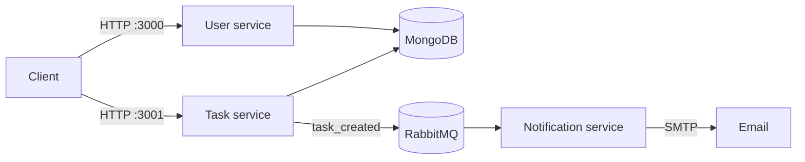

# MCSTASKMANAGER

A microservices task manager built with Node.js, TypeScript, MongoDB and RabbitMQ. Users register and log in, create tasks, and get an email notification whenever a task is created.

## Features

- **User service:** registration with duplicate-email detection, login with JWT, protected user listing
- **Task service:** create, read, update and delete tasks
- **Notification service:** asynchronous email notifications driven by RabbitMQ events
- **Security:** bcrypt password hashing, JWT auth, zod input validation, rate limiting, CORS allow-list
- **Docker:** multi-stage builds, non-root containers, one command to run everything
- **Tests:** unit and integration tests with Jest and supertest

## Architecture



Full details are in [docs/TECHNICAL_DOCUMENTATION.md](docs/TECHNICAL_DOCUMENTATION.md).

## Tech stack

| Layer               | Technology                                      |
| ------------------- | ----------------------------------------------- |
| Runtime / language  | Node.js 22, TypeScript                          |
| Web framework       | Express                                         |
| Database            | MongoDB with Mongoose                           |
| Messaging           | RabbitMQ (amqplib)                              |
| Auth and validation | JWT, bcrypt, zod                                |
| Email               | Nodemailer (Gmail)                              |
| Containers          | Docker, Docker Compose                          |
| Testing             | Jest, ts-jest, supertest, mongodb-memory-server |

## Project structure

```
MCSTASKMANAGER/
├── User_service/      registration, login, JWT
├── Task_service/      task CRUD, publishes events
├── Noti_services/     consumes events, sends email
├── docs/              technical documentation
├── scripts/           smoke test
├── docker-compose.yml
├── env.example
└── README.md
```

Each service has its own `src/` (config, controllers, middlewares, models, routes, types, validators), `tests/`, `Dockerfile` and `package.json`.

## Getting started

### Prerequisites

- [Docker](https://www.docker.com/) and Docker Compose
- Node.js 22 and npm (only needed to run tests or develop outside Docker)
- A Gmail account with an [app password](https://support.google.com/accounts/answer/185833) (for email notifications)

### Setup

1. Clone the repository:

   ```bash
   git clone https://github.com/<your-username>/<repo-name>.git
   cd <repo-name>
   ```

2. Create your environment file:

   ```bash
   cp env.example .env
   ```

   Edit `.env` and set the values from the table below.

3. Start everything:

   ```bash
   docker compose up --build
   ```

4. Check the logs for `Connected to MongoDB`, `User service listening on port 3000`, `Task service listening on port 3001` and `Notification service is listening to messages`.

> Ports shown here are the service defaults. Check `docker-compose.yml` for the exact mappings.

## Configuration

| Variable         | Used by              | Required | Description                             |
| ---------------- | -------------------- | -------- | --------------------------------------- |
| `JWT_SECRET`     | User service         | yes      | Long random string used to sign tokens  |
| `JWT_EXPIRES_IN` | User service         | no       | Token lifetime (default `1d`)           |
| `CORS_ORIGIN`    | User service         | no       | Comma-separated allowed browser origins |
| `EMAIL_USER`     | Notification service | yes      | Gmail address to send from              |
| `EMAIL_PASS`     | Notification service | yes      | Gmail app password                      |

Generate a secret with:

```bash
node -e "console.log(require('crypto').randomBytes(48).toString('hex'))"
```

## API overview

| Service | Method | Path        | Auth         | Description           |
| ------- | ------ | ----------- | ------------ | --------------------- |
| User    | POST   | `/users`    | none         | Register              |
| User    | POST   | `/login`    | none         | Log in, returns a JWT |
| User    | GET    | `/users`    | Bearer token | List users            |
| Task    | POST   | `/task`     | none\*       | Create a task         |
| Task    | GET    | `/task`     | none\*       | List tasks            |
| Task    | PUT    | `/task/:id` | none\*       | Update a task         |
| Task    | DELETE | `/task/:id` | none\*       | Delete a task         |

\* Authentication for the Task service is on the roadmap.

### Example

```bash
# Register
curl -X POST http://localhost:3000/users \
  -H "Content-Type: application/json" \
  -d '{"name":"Ada Lovelace","email":"ada@example.com","password":"password123"}'

# Log in
curl -X POST http://localhost:3000/login \
  -H "Content-Type: application/json" \
  -d '{"email":"ada@example.com","password":"password123"}'

# List users (use the token from the login response)
curl http://localhost:3000/users -H "Authorization: Bearer <token>"

# Create a task
curl -X POST http://localhost:3001/task \
  -H "Content-Type: application/json" \
  -d '{"title":"Write docs","description":"README","userId":"user-1","userEmail":"ada@example.com"}'
```

Full request and response details are in the [technical documentation](docs/TECHNICAL_DOCUMENTATION.md#4-api-reference).

## Running the tests

Inside `User_service/`, `Task_service/` or `Noti_services/`:

```bash
npm install
npm run test:unit          # unit tests (no database needed)
npm run test:integration   # integration tests (User and Task services)
npm run test:coverage      # coverage report
```

> Use TypeScript 5.x (`npm install -D typescript@5`). `ts-jest` does not support TypeScript 7 yet. The first integration run downloads a MongoDB binary.

To test the whole stack after `docker compose up --build`:

```bash
bash scripts/smoke-test.sh
```

## Known limitations and roadmap

- [ ] JWT verification, validation, rate limiting and CORS on the Task service
- [ ] Look up the notification email from the user ID instead of trusting the request
- [ ] Retry and dead-letter handling in the notification service
- [ ] Separate database per service
- [ ] Move hardcoded URIs and ports to environment variables
- [ ] CI pipeline running the tests on every push

API specification: [docs/openapi.yaml](docs/openapi.yaml)

## Contributing

1. Fork the repository and create a branch: `git checkout -b feature/my-change`
2. Make your changes and add or update tests
3. Run `npm run test:unit` (and `test:integration`) in the services you changed
4. Open a pull request describing what changed and why

## Author

Muhammad Yakubu, hijaz10(https://github.com/hijaz10)
